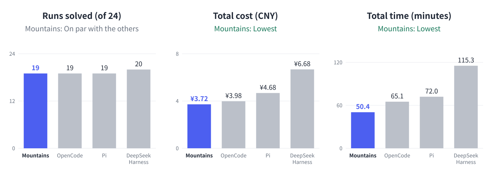

# Mountains Preview 1

[中文](README.md) | English

Mountains is a coding agent: an engine plus a single-command CLI. Give it a task and a directory; it reads code, edits it, runs commands, and exits when done.

Preview 1 is a technical experiment, not an everyday tool: there is no interactive interface, no multi-turn conversation, and it has only been tested on macOS. We are publishing it to show how the context management and tool design below perform on real tasks. A desktop app comes with Preview 2.

## Results

One model (DeepSeek V4.1 Flash, reasoning effort high), the same 12 bug-fix tasks from real repositories, 2 runs per task, 24 runs in total.



| System | Version | Solved | Cost (CNY) | Time (min) |
|---|---|---|---|---|
| **Mountains** | Preview 1 | 19/24 | **3.72** | **50.4** |
| [OpenCode](https://github.com/sst/opencode) | 1.18.32 | 19/24 | 3.98 | 65.1 |
| [Pi](https://github.com/badlogic/pi-mono) | 0.87.1 | 19/24 | 4.68 | 72.0 |
| [DeepSeek Harness](https://github.com/deepseek-ai/deepseek-harness) | 0.2.0 | **20/24** | 6.68 | 115.3 |

In short: about as many tasks solved as the other three, at the lowest cost and in the least time.

### Tasks

"Solved" per task is how many of its 2 runs succeeded.

| Task | Language | Difficulty | Problem | Mountains | OpenCode | Pi | DeepSeek Harness |
|---|---|---|---|---|---|---|---|
| [pallets/flask#5014](https://github.com/pallets/flask/pull/5014) | Python | Ordinary | An empty Blueprint name should raise an error | 2 | 2 | 2 | 2 |
| [psf/requests#6028](https://github.com/psf/requests/pull/6028) | Python | Ordinary | Proxy authentication returns 407 on Python 3.8.12 | 2 | 2 | 2 | 2 |
| [astropy/astropy#14995](https://github.com/astropy/astropy/pull/14995) | Python | Ordinary | NDDataRef mask propagation fails when one operand has no mask | 2 | 2 | 2 | 2 |
| [pydata/xarray#7393](https://github.com/pydata/xarray/pull/7393) | Python | Ordinary | `stack` casts an int32 coordinate to int64 | 2 | 2 | 2 | 2 |
| [immutable-js/immutable-js#2005](https://github.com/immutable-js/immutable-js/pull/2005) | JavaScript | Hard | OrderedSet equality and hashCode are wrong | 2 | 1 | 1 | 2 |
| [thlorenz/doctoc#328](https://github.com/thlorenz/doctoc/pull/328) | JavaScript | Ordinary | Text such as `h#` in a heading causes an invalid regular expression | 0 | 0 | 0 | 0 |
| [cthackers/adm-zip#559](https://github.com/cthackers/adm-zip/pull/559) | JavaScript | Ordinary | addLocalFolderPromise fails with an absolute path on macOS | 2 | 2 | 2 | 2 |
| [rollup/rollup#6041](https://github.com/rollup/rollup/pull/6041) | JavaScript | Hard | The `in` optimization in 4.46 breaks styled-components | 0 | 0 | 0 | 0 |
| [kepano/defuddle#243](https://github.com/kepano/defuddle/pull/243) | TypeScript | Ordinary | Empty tables with no text are kept in the output | 2 | 2 | 2 | 2 |
| [stleary/JSON-java#995](https://github.com/stleary/JSON-java/pull/995) | Java | Ordinary | With keepStrings, `<t>null</t>` is parsed as null | 1 | 2 | 2 | 2 |
| [google/gson#1093](https://github.com/google/gson/pull/1093) | Java | Ordinary | In lenient mode, `value(double)` rejects NaN and Infinity | 2 | 2 | 2 | 2 |
| [gin-gonic/gin#1805](https://github.com/gin-gonic/gin/pull/1805) | Go | Ordinary | With StaticFS, one 404 is logged twice | 2 | 2 | 2 | 2 |

Tasks come from SWE-bench Verified, SWE-bench Multilingual and SWE-bench-Live MultiLang. Difficulty is our own rating of how much code a fix requires understanding.

### How we tested

- **Model:** all four systems used DeepSeek V4.1 Flash, reasoning effort high, at most 32,000 output tokens per request.
- **Task input:** the agent received only the original issue text and the repository at the corresponding commit.
- **Grading:** the hidden tests that came with the fix, plus the repository's existing regression tests; a run counts as solved only if all pass. The agent cannot see the hidden tests.
- **Environment:** the same Mac, the same sandbox and launch method. Cost cap per run: 2 CNY for ordinary tasks, 4 CNY for hard ones.
- **Cost:** computed from the usage DeepSeek reported and its official off-peak prices (per million tokens: cache hit 0.02 CNY, cache miss 1 CNY, output 4 CNY).
- **Time:** from agent process start to exit, summed over 24 runs.
- **Other systems:** each ran in its normal headless mode with its default capabilities; nothing was turned off.

### Caveats

- **This is the author's own test.** We built the task set, the grader and the environment ourselves.
- **The prompt was tuned on these 12 tasks.** Mountains' system prompt and tool notes were written after the author had seen earlier results on these tasks. This favors Mountains, so the results describe its performance on these tasks only; they are not an independent benchmark.
- **Small sample.** 12 tasks, 2 runs each: one run is about 4 percentage points.
- **Different run dates.** The other three systems ran on 2026-10-06, Mountains on 2026-10-11. Both days used the same off-peak prices.
- **Two tasks were solved by none of the four** (doctoc, rollup).

## Design

### Context

- **From 60% of the window: lossless folding.** The program decides which old tool results the model will not need again: those superseded by a later read or edit, those whose same call later succeeded again, failures that later succeeded on retry, and results from requests finished before the last two user requests. Each becomes a one-line notice; the original is archived and can be retrieved. Results fold in batches so the prompt cache is broken rarely.
- **From 90%: the model writes a summary.** When lossless folding is not enough, the model summarizes the earlier work, which replaces the old tool interactions. That request reuses the cached prefix. If it fails, the program writes a factual record instead.
- **Never folded:** user messages, the final answer of each turn, and results the model has not seen yet.
- **No budget.** The model is not given a token allowance.

### Tools

Six tools: `query_plan` (search, list and read files in one call), `file_read`, `file_edit`, `file_write`, `command_run`, and `context_expand` (retrieve a folded original). In addition, `session_search` searches this session's history and `task_note` lets the model record its working state.

## Usage

Requires Node.js 22.19 or later and [ripgrep](https://github.com/BurntSushi/ripgrep) (`rg`).

```bash
npm install
```

```bash
export DEEPSEEK_API_KEY=your-key
export MOUNTAINS_BUDGET=10
```

`MOUNTAINS_BUDGET` caps the total spent across all runs (in CNY). The cap for each run goes in a config file, for example `config.json`:

```json
{ "billingCurrency": "CNY", "limits": { "maxCost": 2 } }
```

```bash
npm run mountains -- run --task "Fix add returning the wrong result" --workspace ./my-project --config config.json
```

Mountains edits the files in `--workspace` directly. Run it in a directory under version control, or one you can throw away.

Check the code:

```bash
npm run check
```

## License

[Apache License 2.0](LICENSE)
