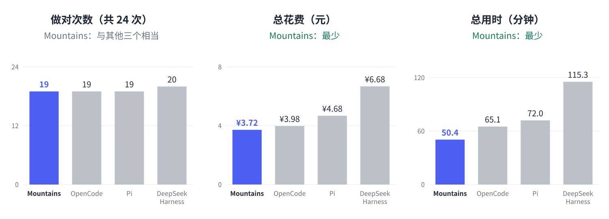

# Mountains Preview 1

中文 | [English](README.en.md)

Mountains 是一个编码 Agent：一个内核，加一个单命令 CLI。给它一个任务和一个目录，它读代码、改代码、跑命令，做完就退出。

Preview 1 是一次技术实验，不是日常工具：没有交互界面，没有多轮对话。我们公开它，是为了展示下面这套上下文管理和工具设计在真实题目上的表现。桌面版会在 Preview 2 推出。

## 测试结果

同一个模型（DeepSeek V4.1 Flash，思考强度 high），同样 12 道真实仓库的修 bug 题，每题跑 2 次，共 24 次。



| 系统 | 版本 | 做对 | 花费（元） | 用时（分钟） |
|---|---|---|---|---|
| **Mountains** | Preview 1 | 19/24 | **3.72** | **50.4** |
| [OpenCode](https://github.com/sst/opencode) | 1.18.32 | 19/24 | 3.98 | 65.1 |
| [Pi](https://github.com/badlogic/pi-mono) | 0.87.1 | 19/24 | 4.68 | 72.0 |
| [DeepSeek Harness](https://github.com/deepseek-ai/deepseek-harness) | 0.2.0 | **20/24** | 6.68 | 115.3 |

简单说：做对的数量和其他三个差不多，花费和用时最少。

### 题目

每题的「做对」是 2 次里做对几次。

| 题目 | 语言 | 难度 | 问题 | Mountains | OpenCode | Pi | DeepSeek Harness |
|---|---|---|---|---|---|---|---|
| [pallets/flask#5014](https://github.com/pallets/flask/pull/5014) | Python | 普通 | Blueprint 名字为空时应报错 | 2 | 2 | 2 | 2 |
| [psf/requests#6028](https://github.com/psf/requests/pull/6028) | Python | 普通 | Python 3.8.12 下代理认证返回 407 | 2 | 2 | 2 | 2 |
| [astropy/astropy#14995](https://github.com/astropy/astropy/pull/14995) | Python | 普通 | NDDataRef 一边没有 mask 时，mask 传播出错 | 2 | 2 | 2 | 2 |
| [pydata/xarray#7393](https://github.com/pydata/xarray/pull/7393) | Python | 普通 | stack 把 int32 坐标变成 int64 | 2 | 2 | 2 | 2 |
| [immutable-js/immutable-js#2005](https://github.com/immutable-js/immutable-js/pull/2005) | JavaScript | 困难 | OrderedSet 的相等判断和 hashCode 有误 | 2 | 1 | 1 | 2 |
| [thlorenz/doctoc#328](https://github.com/thlorenz/doctoc/pull/328) | JavaScript | 普通 | 标题含 `h#` 这类文字时正则报错 | 0 | 0 | 0 | 0 |
| [cthackers/adm-zip#559](https://github.com/cthackers/adm-zip/pull/559) | JavaScript | 普通 | macOS 上传绝对路径时 addLocalFolderPromise 失败 | 2 | 2 | 2 | 2 |
| [rollup/rollup#6041](https://github.com/rollup/rollup/pull/6041) | JavaScript | 困难 | 4.46 的 `in` 优化弄坏了 styled-components | 0 | 0 | 0 | 0 |
| [kepano/defuddle#243](https://github.com/kepano/defuddle/pull/243) | TypeScript | 普通 | 没有文字的空表格被保留进输出 | 2 | 2 | 2 | 2 |
| [stleary/JSON-java#995](https://github.com/stleary/JSON-java/pull/995) | Java | 普通 | keepStrings 下 `<t>null</t>` 被解析成 null | 1 | 2 | 2 | 2 |
| [google/gson#1093](https://github.com/google/gson/pull/1093) | Java | 普通 | 宽松模式下 `value(double)` 不接受 NaN 和 Infinity | 2 | 2 | 2 | 2 |
| [gin-gonic/gin#1805](https://github.com/gin-gonic/gin/pull/1805) | Go | 普通 | 用 StaticFS 时一个 404 打出两行日志 | 2 | 2 | 2 | 2 |

题目来自 SWE-bench Verified、SWE-bench Multilingual 和 SWE-bench-Live MultiLang。难度是我们按修复需要理解的代码范围评的。

### 怎么测的

- **模型：** 四个系统都用 DeepSeek V4.1 Flash，思考强度 high，单次输出上限 32,000 token。
- **题面：** Agent 只拿到原始 issue 的文字和对应提交时的仓库。
- **评分：** 用这次修复附带的隐藏测试，加上仓库原有的回归测试，全部通过才算做对。Agent 运行时看不到隐藏测试。
- **环境：** 同一台 Mac，同一个沙箱和启动方式。每次运行的花费上限：普通题 2 元，困难题 4 元。
- **花费：** 按 DeepSeek 返回的实际用量和官方闲时价格计算（缓存命中 0.02 元、未命中 1 元、输出 4 元，每百万 token）。
- **用时：** Agent 进程从启动到退出的时间，24 次相加。
- **对手设置：** 其他三个系统都用各自正常的无界面模式和默认能力，没有关掉任何功能。

### 需要说明的

- **这是作者自测。** 题目、评分程序和运行环境都是我们自己搭的。
- **提示词是在这 12 道题上调的。** Mountains 的系统提示和工具说明，是作者看过这些题上的早期结果之后写的。这对 Mountains 有利，所以这份结果只能说明它在这些题上的表现，不能当成独立的基准。
- **样本小。** 12 道题、每题 2 次，1 次的差别就是 4 个百分点。
- **运行日期不同。** 其他三个系统在 2026-10-06 运行，Mountains 在 2026-10-11 运行。两天用的是同一套闲时价格。
- **两道题四个系统都没做对**（doctoc、rollup）。

## 设计

### 上下文

- **60% 起：无损折叠。** 由程序判断哪些旧的工具结果模型不会再需要：被后来的读取或编辑覆盖的、后来同样调用又成功一次的、失败后重试成功的、属于两次用户请求之前已经结束的。这些结果换成一行英文说明，原文存档，需要时可以取回。一次折一批，避免频繁打断缓存。
- **90% 起：模型写摘要。** 如果无损折叠不够，就让模型把之前的工作总结一下，替换掉旧的工具交互。这次请求复用已缓存的前缀。摘要失败时，由程序写一份事实记录代替。
- **永远不折叠：** 用户的消息、每轮的最终回答、模型还没看到的结果。
- **没有预算。** 不按 token 数给模型设上限。

### 工具

六个工具：`query_plan`（一次调用里批量搜索、列文件、读文件）、`file_read`、`file_edit`、`file_write`、`command_run`、`context_expand`（取回被折叠的原文）。另外有 `session_search`（搜索本次会话的历史）和 `task_note`（模型记下自己的工作状态）。

## 使用

需要 Node.js 22.19 或更高版本、npm、Git，以及 [ripgrep](https://github.com/BurntSushi/ripgrep)（`rg`）。Git 用来保存文件检查点。

这次补了 Linux 和 Windows 的兼容。CI 配了三个系统，每个系统都检查 Node.js 22.19 和 24。这六项 CI 已通过。

- **Linux、macOS：** 还需要 Bash。精简 Linux 镜像可能没有自带，需要另装；Linux 的进程清理要能读取 `/proc`。
- **Windows 10/11：** 安装 Git for Windows，包含 Git Bash，并保留系统自带的 Windows PowerShell。可以从 PowerShell、cmd 或 Git Bash 启动。
- **WSL：** 按 Linux 安装 Node、Git、rg 和 Bash，都在 WSL 里运行，不要混用 Windows 的 Node。

下面以 DeepSeek 为例。Bash 命令适用于 Linux、macOS 和 Windows 的 Git Bash，PowerShell 写法在后面。先下载仓库并安装依赖：

```bash
git clone https://github.com/pollenkun/Mountains.git
cd Mountains
npm ci
```

设置密钥和累计费用上限。把 `你的密钥` 换成自己的 DeepSeek API 密钥：

```bash
export DEEPSEEK_API_KEY="你的密钥"
export MOUNTAINS_BUDGET=10
```

`MOUNTAINS_BUDGET` 是所有运行累计花费的上限（元）。下面创建 `config.json`，把每次运行的上限设为 2 元：

```bash
cat > config.json <<'JSON'
{ "billingCurrency": "CNY", "limits": { "maxCost": 2 } }
JSON
```

先创建一个可以丢弃的示例目录。里面的 `add` 故意把加法写成了减法：

```bash
mkdir demo-workspace
cat > demo-workspace/add.cjs <<'JS'
exports.add = (a, b) => a - b;
JS
```

Mountains 会直接修改 `--workspace` 里的文件，请在有版本管理或可以丢弃的目录里运行。

`--workspace` 只是任务目录，不是系统级隔离。命令以当前用户权限运行，可能读取或修改目录外的文件，也可能访问网络。默认规则会自动允许一般命令、文件修改和网络访问，不会逐项询问。请在隔离环境中运行不可信任务；仅使用一个可以丢弃的目录，不能保护电脑上的其他文件。

运行任务。这一步会调用 DeepSeek，并产生模型费用：

```bash
npm run mountains -- run --task "修复 add.cjs 中的 add，让它返回两个数的和" --workspace ./demo-workspace --config config.json
```

结束后，终端会显示任务结果、估算费用和记录目录。可以检查加法是否修好了：

```bash
node -e "require('node:assert/strict').equal(require('./demo-workspace/add.cjs').add(2, 3), 5); console.log('OK')"
```

输出 `OK` 表示这个例子通过。处理自己的项目时，把 `--workspace` 换成项目路径，把 `--task` 换成任务描述。以上命令都在 Mountains 仓库目录中执行。

### Windows PowerShell

如果用 PowerShell，在 Mountains 仓库目录中执行下面这些命令。这里用 Node 写文件，避开 Windows PowerShell 5.1 写入 BOM 的问题：

```powershell
npm.cmd ci
$env:DEEPSEEK_API_KEY = "你的密钥"
$env:MOUNTAINS_BUDGET = "10"
node -e "require('node:fs').writeFileSync('config.json', JSON.stringify({billingCurrency:'CNY',limits:{maxCost:2}}))"
node -e "require('node:fs').mkdirSync('demo-workspace',{recursive:true});require('node:fs').writeFileSync('demo-workspace/add.cjs','exports.add = (a, b) => a - b;\n')"
npm.cmd run mountains -- run --task "修复 add.cjs 中的 add，让它返回两个数的和" --workspace ./demo-workspace --config config.json
```

最后一条命令会调用 DeepSeek，产生模型费用，也会直接修改示例目录。

命令工具的 `shellScript` 用 Bash 语法。`argv` 直接调用原生程序；`npm.cmd`、`.bat` 要通过 `cmd.exe /c` 或 Git Bash 调用。Windows PowerShell 用来管理子进程，系统策略禁用它时，命令工具不能运行。

### 命令和后台进程

`command_run` 用来运行临时命令。命令结束、超时或取消时，会尝试清理它启动的进程。需要长期保留的服务，请在单独管理的终端或服务里启动，不要靠命令末尾的 `&` 留在后台。

Windows 用 Job Object 管理进程。Linux 在已有的用户级 systemd 支持 `systemd-run --expand-environment=no` 时，先把命令放进独立的 scope，结束后检查整个 scope 是否为空。这里不新增 Python 运行时要求，也不会替你配置系统服务。

macOS 和没有可用用户级 systemd 的 Linux 只能尽力清理。结果会明确标出清理未确认；过早脱离的后代仍可能遗留。退出码为 0，不代表所有后台进程都已退出。它也不是沙箱，不保证主进程被强杀或系统崩溃后能自动清理。

### 记录和费用

运行记录、回放、归档和费用账本默认放在主目录的 `.mountains` 下，Windows 是 `%USERPROFILE%\.mountains`。设置 `MOUNTAINS_HOME` 可以换目录。配置文件或 `--spend-ledger` 指定的账本路径优先。运行输出、费用账本、检查点和归档目录必须放在任务工作区之外。

以前的 `MOUNTAINS_HOME` 只改归档位置。这次也会改默认账本位置。如果旧的 `~/.mountains/spend.jsonl` 还在、新目录没有账本，CLI 会先停下来。把旧账本搬过去，或用 `--spend-ledger` 继续用原路径，累计费用就不会从零开始。

编译缓存另外存放：Linux 用 `$XDG_CACHE_HOME`（默认 `~/.cache`），macOS 用 `~/Library/Caches`，Windows 用 `%LOCALAPPDATA%`，再加 `mountains/node-compile-cache`。缓存不可用不影响启动。

检查点也会保存文件工具修改前的 Git 忽略文件。通过命令修改的忽略文件，不保证能恢复到修改前；重要文件还是要另外备份。

### 检查

查看帮助，不需要密钥，也不调用模型：

```bash
npm run mountains -- --help
```

检查代码。这些测试在本地跑，不调用付费模型：

```bash
npm run check
```

只跑办公、日常和 Coding 场景：

```bash
npm run test:scenarios
```

这些场景用临时 CSV、Markdown、文本和代码文件，实际执行文件操作、命令、检查点和恢复。模型回复用固定脚本或本地模拟接口，不代表真实模型的任务成功率，也不测试 Word、Excel 等二进制格式。多轮和会话恢复测试用引擎接口；Preview 1 CLI 仍是单任务。

测试还需要 Python 3。Linux、macOS 默认用 `python3`，Windows 默认用 `python`，也可以用 `MOUNTAINS_PYTHON` 指定已有的解释器。Windows 要允许创建符号链接，才能跑相关测试。POSIX 权限、特殊文件名和 macOS 沙箱测试只在对应系统上跑。

## 许可证

[Apache License 2.0](LICENSE)
