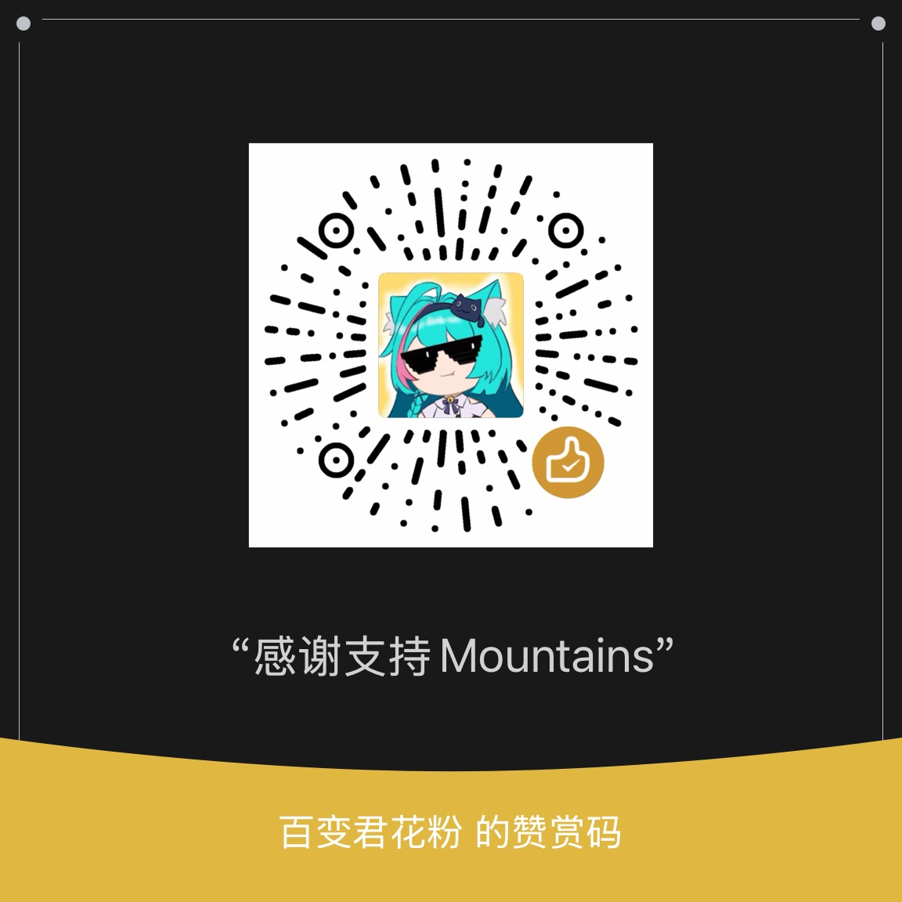

# Mountains Preview 1

English | [中文](README.zh-CN.md)

Mountains is a coding agent: an engine plus a single-command CLI. Give it a task and a directory; it reads code, edits it, runs commands, and exits when done.

Preview 1 is a technical experiment, not an everyday tool: there is no interactive interface or multi-turn conversation. We are publishing it to show how the context management and tool design below perform on real tasks. A desktop app comes with Preview 2.

## Results

One model (DeepSeek V4.1 Flash, reasoning effort high), the same 12 bug-fix tasks from real repositories, 2 runs per task, 24 runs in total.


These results were measured at the [`preview-1`](https://github.com/pollenkun/Mountains/tree/preview-1) tag. Later fixes did not change the system prompt or tool descriptions the model sees, and were not re-measured. None of the 24 runs reached 60% of the context window, so the later change to compaction at 90% does not affect these results.

| System | Version | Solved | Cost (CNY) | Time (min) |
|---|---|---|---|---|
| **Mountains** | Preview 1 | 19/24 | **3.72** | **50.4** |
| [OpenCode](https://github.com/sst/opencode) | 1.18.32 | 19/24 | 3.98 | 65.1 |
| [Pi](https://github.com/badlogic/pi-mono) | 0.87.1 | 19/24 | 4.68 | 72.0 |
| [DeepSeek Harness](https://github.com/deepseek-ai/deepseek-harness) | 0.2.0 | **20/24** | 6.68 | 115.3 |

In short: about as many tasks solved as the other three, at the lowest cost and in the least time.

### Tasks

"Solved" per task is how many of its 2 runs succeeded.

| Task | Language | Difficulty | Problem | Mountains | OpenCode | Pi | DeepSeek Harness |
|---|---|---|---|---|---|---|---|
| [pallets/flask#5014](https://github.com/pallets/flask/pull/5014) | Python | Ordinary | An empty Blueprint name should raise an error | 2 | 2 | 2 | 2 |
| [psf/requests#6028](https://github.com/psf/requests/pull/6028) | Python | Ordinary | Proxy authentication returns 407 on Python 3.8.12 | 2 | 2 | 2 | 2 |
| [astropy/astropy#14995](https://github.com/astropy/astropy/pull/14995) | Python | Ordinary | NDDataRef mask propagation fails when one operand has no mask | 2 | 2 | 2 | 2 |
| [pydata/xarray#7393](https://github.com/pydata/xarray/pull/7393) | Python | Ordinary | `stack` casts an int32 coordinate to int64 | 2 | 2 | 2 | 2 |
| [immutable-js/immutable-js#2005](https://github.com/immutable-js/immutable-js/pull/2005) | JavaScript | Hard | OrderedSet equality and hashCode are wrong | 2 | 1 | 1 | 2 |
| [thlorenz/doctoc#328](https://github.com/thlorenz/doctoc/pull/328) | JavaScript | Ordinary | Text such as `h#` in a heading causes an invalid regular expression | 0 | 0 | 0 | 0 |
| [cthackers/adm-zip#559](https://github.com/cthackers/adm-zip/pull/559) | JavaScript | Ordinary | addLocalFolderPromise fails with an absolute path on macOS | 2 | 2 | 2 | 2 |
| [rollup/rollup#6041](https://github.com/rollup/rollup/pull/6041) | JavaScript | Hard | The `in` optimization in 4.46 breaks styled-components | 0 | 0 | 0 | 0 |
| [kepano/defuddle#243](https://github.com/kepano/defuddle/pull/243) | TypeScript | Ordinary | Empty tables with no text are kept in the output | 2 | 2 | 2 | 2 |
| [stleary/JSON-java#995](https://github.com/stleary/JSON-java/pull/995) | Java | Ordinary | With keepStrings, `<t>null</t>` is parsed as null | 1 | 2 | 2 | 2 |
| [google/gson#1093](https://github.com/google/gson/pull/1093) | Java | Ordinary | In lenient mode, `value(double)` rejects NaN and Infinity | 2 | 2 | 2 | 2 |
| [gin-gonic/gin#1805](https://github.com/gin-gonic/gin/pull/1805) | Go | Ordinary | With StaticFS, one 404 is logged twice | 2 | 2 | 2 | 2 |

Tasks come from SWE-bench Verified, SWE-bench Multilingual and SWE-bench-Live MultiLang. Difficulty is our own rating of how much code a fix requires understanding.

### How we tested

- **Model:** all four systems used DeepSeek V4.1 Flash, reasoning effort high, at most 32,000 output tokens per request.
- **Task input:** the agent received only the original issue text and the repository at the corresponding commit.
- **Grading:** the hidden tests that came with the fix, plus the repository's existing regression tests; a run counts as solved only if all pass. The agent cannot see the hidden tests.
- **Environment:** the same Mac, the same sandbox and launch method. Cost cap per run: 2 CNY for ordinary tasks, 4 CNY for hard ones.
- **Cost:** computed from the usage DeepSeek reported and its official off-peak prices (per million tokens: cache hit 0.02 CNY, cache miss 1 CNY, output 4 CNY).
- **Time:** from agent process start to exit, summed over 24 runs.
- **Other systems:** each ran in its normal headless mode with its default capabilities; nothing was turned off.

### Caveats

- **This is the author's own test.** We built the task set, the grader and the environment ourselves.
- **The prompt was tuned on these 12 tasks.** Mountains' system prompt and tool notes were written after the author had seen earlier results on these tasks. This favors Mountains, so the results describe its performance on these tasks only; they are not an independent benchmark.
- **Small sample.** 12 tasks, 2 runs each: one run is about 4 percentage points.
- **Different run dates.** The other three systems ran on 2026-10-06, Mountains on 2026-10-11. Both days used the same off-peak prices.
- **Two tasks were solved by none of the four** (doctoc, rollup).

## Design

### Context

- **From 60% of the window: lossless folding.** The program decides which old tool results the model will not need again: those superseded by a later read or edit, those whose same call later succeeded again, failures that later succeeded on retry, and results from requests finished before the last two user requests. Each becomes a one-line notice; the original is archived and can be retrieved. Results fold in batches so the prompt cache is broken rarely.
- **From 90%: the model writes a summary.** When lossless folding is not enough, the model summarizes everything earlier, the user's earlier messages and answers included; the originals are archived and the model can retrieve the exact wording. That request reuses the cached prefix. If it fails, the program writes a factual record instead.
- **Always kept verbatim:** the newest request, the most recent work, and results the model has not seen yet. Lossless folding at 60% never touches user messages or the final answer of each turn.
- **No budget.** The model is not given a token allowance.

### Tools

Six tools: `query_plan` (search, list and read files in one call), `file_read`, `file_edit`, `file_write`, `command_run`, and `context_expand` (retrieve a folded original). In addition, `session_search` searches this session's history and `task_note` lets the model record its working state.

## Usage

Requires Node.js 22.19 or later, npm, Git, and [ripgrep](https://github.com/BurntSushi/ripgrep) (`rg`). Git stores file checkpoints.

Linux, macOS and Windows are supported. CI checks each of them with Node.js 22.19 and 24.

- **Linux, macOS:** Bash is also required. Minimal Linux images may need it installed separately; process cleanup needs access to `/proc` on Linux.
- **Windows 10/11:** install Git for Windows, including Git Bash, and keep the built-in Windows PowerShell available. Start from PowerShell, cmd, or Git Bash.
- **WSL:** install and run Linux Node, Git, rg, and Bash inside WSL. Do not mix in Windows Node.

The example below uses DeepSeek. Its Bash commands work on Linux, macOS, and Git Bash on Windows; PowerShell commands follow below. Download the repository and install its dependencies:

```bash
git clone https://github.com/pollenkun/Mountains.git
cd Mountains
npm ci
```

Set your API key and cumulative spending cap. Replace `your-key` with your DeepSeek API key:

```bash
export DEEPSEEK_API_KEY="your-key"
export MOUNTAINS_BUDGET=10
```

`MOUNTAINS_BUDGET` caps the total spent across all runs (in CNY). Create `config.json` to cap each run at 2 CNY:

```bash
cat > config.json <<'JSON'
{ "billingCurrency": "CNY", "limits": { "maxCost": 2 } }
JSON
```

Create a disposable example directory. Its `add` function deliberately subtracts instead of adding:

```bash
mkdir demo-workspace
cat > demo-workspace/add.cjs <<'JS'
exports.add = (a, b) => a - b;
JS
```

Mountains edits the files in `--workspace` directly. Run it in a directory under version control, or one you can throw away.

`--workspace` sets the task directory; it is not an operating-system sandbox. Commands run with your user account's permissions and can read or modify files outside that directory and access the network. The default policy automatically allows ordinary commands, file changes and network access without asking each time. Run untrusted tasks in an isolated environment; a disposable directory alone does not protect other files on your computer.

Run the task. This step calls DeepSeek and incurs model charges:

```bash
npm run mountains -- run --task "Fix add in add.cjs so it returns the sum of two numbers" --workspace ./demo-workspace --config config.json
```

When it finishes, the terminal shows the result, estimated cost and recording directory. Check that the example was fixed:

```bash
node -e "require('node:assert/strict').equal(require('./demo-workspace/add.cjs').add(2, 3), 5); console.log('OK')"
```

An `OK` result means this example passes. For your own project, replace `--workspace` with its path and `--task` with your request. Run all the commands above from the Mountains repository directory.

### Windows PowerShell

If you use PowerShell, run these commands from the Mountains repository directory. Node writes the files to avoid the BOM added by Windows PowerShell 5.1:

```powershell
npm.cmd ci
$env:DEEPSEEK_API_KEY = "your-key"
$env:MOUNTAINS_BUDGET = "10"
node -e "require('node:fs').writeFileSync('config.json', JSON.stringify({billingCurrency:'CNY',limits:{maxCost:2}}))"
node -e "require('node:fs').mkdirSync('demo-workspace',{recursive:true});require('node:fs').writeFileSync('demo-workspace/add.cjs','exports.add = (a, b) => a - b;\n')"
npm.cmd run mountains -- run --task "Fix add in add.cjs so it returns the sum of two numbers" --workspace ./demo-workspace --config config.json
```

The last command calls DeepSeek, incurs model charges, and edits the example directory directly.

The command tool uses Bash syntax for `shellScript`. Direct `argv` calls need a native executable; run `npm.cmd` and `.bat` files through `cmd.exe /c` or Git Bash. Windows PowerShell manages child processes. If system policy blocks it, the command tool cannot run.

### Commands and background processes

`command_run` runs temporary commands. It attempts to clean up their processes when the command ends, times out, or is cancelled. Start long-running services in a separately managed terminal or service, rather than relying on a trailing `&` to keep them alive.

Windows uses Job Objects. On Linux with an available user-systemd manager and support for `systemd-run --expand-environment=no`, the command enters its own scope before starting, and cleanup checks that the whole scope is empty. This adds no Python runtime requirement and does not configure system services for you.

macOS and Linux without usable user-systemd have best-effort cleanup. Results explicitly mark cleanup as unconfirmed; descendants that detach too early can survive. Exit code 0 does not mean every background process has stopped. This is not a sandbox, and cleanup is not guaranteed after the host process is forcibly killed or the system crashes.

### Recordings and spending

Recordings, replays, archives, and the spending ledger go in `.mountains` under your home directory (`%USERPROFILE%\.mountains` on Windows). Set `MOUNTAINS_HOME` to use another directory. A ledger path set in the config or through `--spend-ledger` takes precedence. Run output, the spending ledger, checkpoints, and archives must stay outside the task workspace.

When `MOUNTAINS_HOME` is set, if `~/.mountains/spend.jsonl` already holds a ledger and the new directory has none, the CLI stops first. Move the old ledger over, or keep its original path with `--spend-ledger`, so cumulative spending does not restart at zero.

The compile cache is separate: Linux uses `$XDG_CACHE_HOME` (default `~/.cache`), macOS uses `~/Library/Caches`, and Windows uses `%LOCALAPPDATA%`, followed by `mountains/node-compile-cache`. An unavailable cache does not prevent startup.

Checkpoints also save Git-ignored files before file tools change them. Changes to ignored files made by commands may not be recoverable. Keep a separate backup of important files.

### Skills

A skill is a folder holding `SKILL.md` in the [Agent Skills](https://agentskills.io/specification) format, so skills written for other agents work as they are:

```markdown
---
name: changelog
description: Write changelog entries in the project's format. Use when writing or editing CHANGELOG.
---

Use Keep a Changelog headings…
```

Mountains looks for skills here, and the first one found wins a name: the project's `.mountains/skills` and `.agents/skills` (from the workspace up to the repository root), the folders listed in `skills.dirs` in the config, `~/.mountains/skills`, and `~/.agents/skills`.

The model sees only each skill's name and description, and loads the full instructions and bundled files with the `skill` tool when it needs them. A task that starts with `/skill-name` brings that skill in directly, for example `--task "/changelog write the 2.1 entry"`. With no skills installed, the model sees exactly the tools and prompt of the version measured above.

Project skills come from the repository and may tell the model to run scripts, so by default someone has to approve them before they load; a CLI run has no one to ask, so it does not load them. Allow the ones you trust by name in the config; `*` matches any characters:

```json
{ "skills": { "permissions": { "changelog": "allow", "deploy-*": "deny" } } }
```

### Checks

Help requires no API key and sends no model request:

```bash
npm run mountains -- --help
```

Check the code. These tests run locally and make no paid model calls:

```bash
npm run check
```

Run only the office, daily-work and coding scenarios:

```bash
npm run test:scenarios
```

These scenarios use temporary CSV, Markdown, text and source files, with real file operations, commands, checkpoints and recovery. Model responses come from fixed scripts or a local mock server. They do not measure real-model task success or test Word/Excel binary formats. Multi-request and session-restoration tests use the engine API; the Preview 1 CLI remains single-task.

The tests also need Python 3: `python3` on Linux/macOS, or `python` on Windows. Use `MOUNTAINS_PYTHON` to select another installed interpreter. Windows must allow symlink creation for those tests to run. POSIX permissions, special filenames, and macOS sandbox tests run only on the relevant systems.

## License

[Apache License 2.0](LICENSE)

## Support Mountains

If Mountains has been useful to you, you're welcome to buy me a coffee via the WeChat appreciation code below. Your support helps me keep building and improving Mountains.

Support is entirely optional. Ideas, bug reports, and contributions are just as welcome. Thank you for being part of Mountains!

<p align="center">
  
</p>
